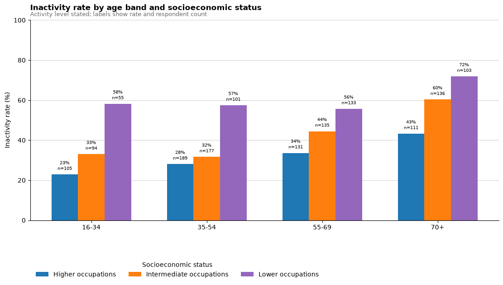

# Active Lives Insights

**A Python data science project on physical inactivity in Exeter and Cranbrook.**

Who reported the least physical activity, and how well can questionnaire responses identify inactivity? This project uses a local survey extract to compare inactivity across age, occupation and neighbourhood groups, then evaluates two XGBoost models on held-out responses.

[Survey findings](#survey-findings) · [Model results](#model-results) · [Project walkthrough](#project-walkthrough)

## Survey findings

**716 of 1,636 respondents with a stated activity level (43.8%)** were classified as inactive, defined here as less than 30 minutes of moderate physical activity.

Respondents in lower occupational groups reported higher inactivity than those in higher occupational groups in every age band shown. Among respondents aged 70 and over, **71.8% (74 of 103)** in lower occupational groups were inactive, compared with **43.2% (48 of 111)** in higher occupational groups. That gap is a starting point for investigating barriers to activity.



*Unweighted results for survey respondents. Each bar shows the rate and number of respondents in that subgroup.*

## Model results

The notebook compared a three-class model (inactive, fairly active, active) with a binary model (inactive, not inactive). Both were evaluated on the same stratified 20% holdout.

| XGBoost model | Inactive precision | Inactive recall | Inactive F1 |
| --- | ---: | ---: | ---: |
| Three activity levels | 71.8% | 51.4% | 0.599 |
| Inactive vs. not inactive | 72.7% | 64.6% | **0.684** |

The binary model identified more inactive respondents at similar precision. In a separate check, sigmoid calibration did not improve the three-class model's holdout scores. Across all five validation folds, the survey score combining perceived ability, opportunity, enjoyment and motivation ranked first by mean absolute SHAP value for the three-class model's inactive prediction.

The rates describe this survey sample. SHAP explains the fitted model's predictions; it does not establish what causes inactivity. The models were evaluated within one local survey extract, so performance elsewhere is unknown.

## Project walkthrough

| Notebook | What to look for |
| --- | --- |
| `Master_dip.ipynb` | Questionnaire recoding, composite features and subgroup charts. Start at **Subgroup analysis: socioeconomic status, age and area** for the descriptive results, then see **Robust model validation and SHAP stability** for the stratified split, five-fold tuning, calibration and model explanations. |
| `area_classification.ipynb` | Postcode normalisation and joins to Office for National Statistics geography. The recorded run preserved all **1,664** rows, changed **34** area assignments and flagged **4** as uncertain. It checks for lost rows, duplicate case IDs and inconsistent assignments. |
| `data_convert.ipynb` | Conversion from SPSS to CSV and Excel with `pyreadstat`, including extraction of question labels and coded answers into the [survey codebook](variable_view_with_value_labels.csv). |

<details>
<summary>Local setup and data requirements</summary>

The analysis notebook records Python 3.12. From the repository root, install the dependencies in a virtual environment and launch JupyterLab:

```bash
python -m pip install jupyterlab pandas numpy scipy scikit-learn xgboost shap matplotlib seaborn openpyxl
python -m jupyterlab
```

Open `Master_dip.ipynb` with the classified survey CSV (`data_raw__no_index.csv`) and the codebook (`variable_view_with_value_labels.csv`) beside it. Use respondent-level inputs only where you are authorised to do so. This is the shortest route through the analysis; the geographic preparation has already been applied to the CSV.

To repeat geographic preparation, supply the May 2026 ONS Postcode Directory extract for the EX postcode area and the 2021 LSOA to 2024 ward and local authority lookup, using the filenames in `area_classification.ipynb`. To repeat the SPSS export, also install `pyreadstat` and supply `LAL 2025.sav`. Run either preparation notebook on a working copy: both can overwrite the analysis CSV.

</details>

> **Data sharing:** The charts and figures on this page are aggregate. The repository also contains respondent-level survey records and notebook outputs, including full postcodes. Verify that those files are approved for public release before sharing the repository.
